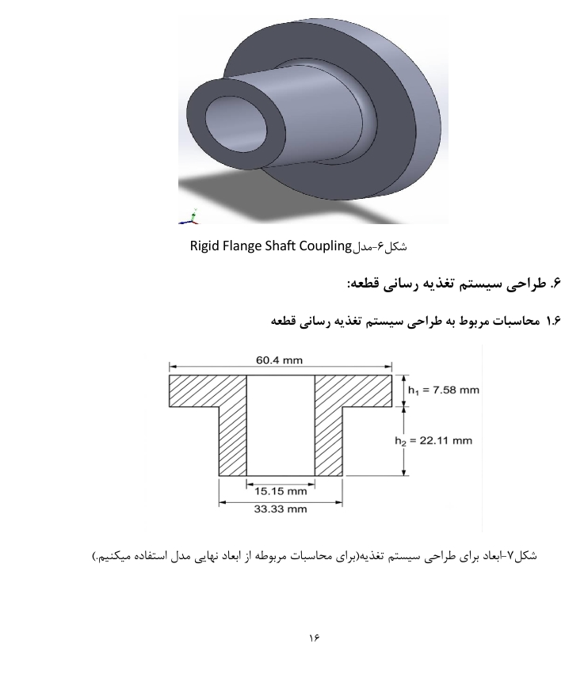
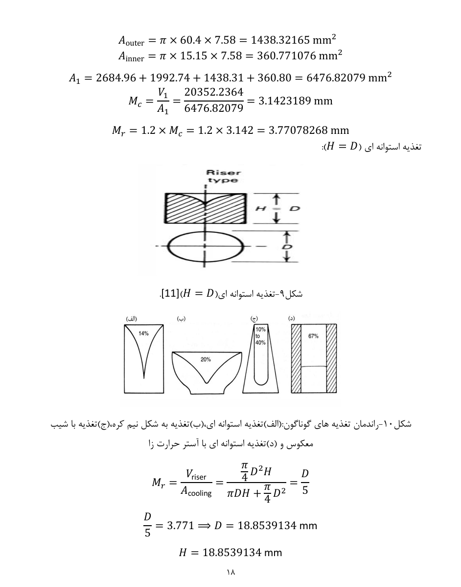
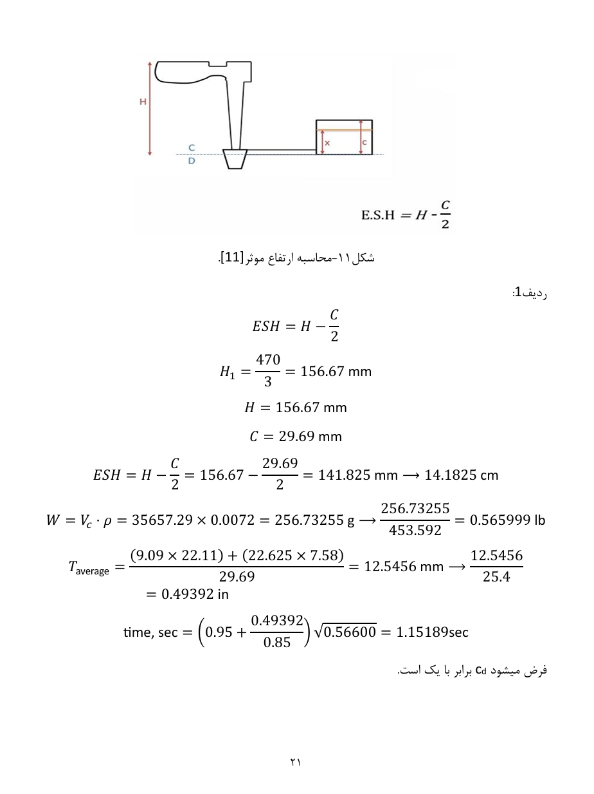

# Rigid Flange Coupling — Casting Design

## 1. Project Overview

This project focuses on the design of a gating and feeding system for a rigid flange shaft coupling using casting engineering principles.

The objective is to develop a suitable casting layout that promotes complete mold filling, supports directional solidification, reduces turbulence, and minimizes molten metal waste.

## 2. Component and Material

- **Component:** Rigid flange shaft coupling
- **Material:** Gray cast iron
- **Material specification:** ASTM A48 Class 30B
- **Molding process:** DISAMATIC vertical flaskless green-sand molding
- **CAD software:** SolidWorks

## 3. Casting Model Design

The casting model was developed by considering dimensional allowances and molding requirements, including shrinkage allowance, machining allowance, draft angles, and internal cavity design.

*Figure 1. Rigid flange coupling casting model.*

## 4. Feeding System Design

The feeding system was designed using casting volume, cooling surface area, and modulus calculations. Riser sizing was evaluated to support directional solidification and reduce the risk of shrinkage defects.

*Figure 2. Feeding system design for the rigid flange coupling.*

## 5. Gating System Design

The gating system was designed to facilitate mold filling while considering the estimated casting weight, effective metallostatic head, and filling time.

The system includes the sprue, runner, gates, and associated pouring features.

*Figure 3. Gating system design for the casting.*

## 6. Design Objectives

- Achieve complete mold filling.
- Reduce turbulence during molten metal flow.
- Promote directional solidification.
- Reduce shrinkage-related defect risk.
- Improve feeding efficiency.
- Minimize excess molten metal and unnecessary machining.

## 7. Engineering Skills

- Casting process selection
- SolidWorks CAD modeling
- Casting allowances
- Modulus and riser design calculations
- Gating system design
- Feeding system design
- Directional solidification principles
- Casting process optimization

## 8. Complete Project Report

The complete report includes the design methodology, engineering calculations, and casting system design details.

[View or download the complete casting project report (PDF)](./casting.pdf)
